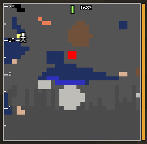
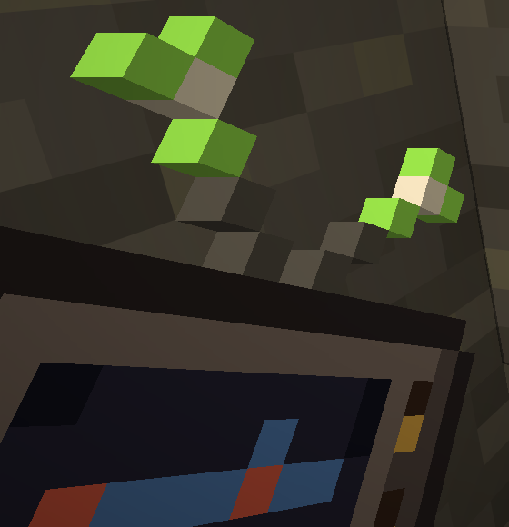

# Compass

A compass in a module slot. It holds the cut in one direction.

| Locked at 168°, needle green | The CRT's antennas light up |
|---|---|
|  |  |

## What it does
- **K** locks the cut in the direction you look, at any angle (a diagonal tunnel works).
  **K** again lets it follow your view.
- A needle at the top of the picture shows where the cut points, with the bearing in degrees
  (0° = north).
- When you face that direction again, the needle turns green and thick with a clink, and the
  antennas of the CRT in your hand light up.
- A **lodestone compass** points the cut at its lodestone. In another dimension the needle spins.

With "Color blind colors" on in the settings, the needle turns blue instead of green.

---
[Home](Home.md) · [Getting Started](Getting-Started.md) · [Best Practice](Best-Practice.md)
