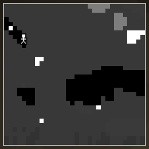

# Copper CRT

The first upgrade: now you see ores.

## How to make it
Smithing table: torch (template) + [Stone CRT](Stone-CRT.md) + [Copper Picture Tube](Picture-Tubes.md).
The fuel in the Stone CRT carries over.

## What it shows
- 32×32 blocks, black and white.
- Caves, water, lava, and **ores as bright dots**.
- A steady picture that only flickers rarely.

## Modules
**1 module slot.** Sneak + right-click with the CRT to open it. The most useful first module is
usually a [Coal Pouch](Coal-Pouch.md), or a [Finder Bundle](Finder-Bundle.md) if you look for one
ore.

## Upgrade
Smithing table: torch + Copper CRT + [Iron Picture Tube](Picture-Tubes.md) → [Iron CRT](Iron-CRT.md).

---
[Home](Home.md) · [Getting Started](Getting-Started.md) · [Best Practice](Best-Practice.md)
