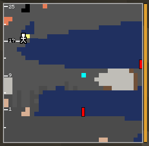

# Depth Gauge

The only module the mod adds as its own item. It shows Y levels in the picture.



## Recipe
```
S N        S = stick
S N        N = copper nugget
S N
```
Three sticks in a column, three copper nuggets beside them.

## What it does
Put it into a module slot (sneak + right-click with the CRT). A white ruler appears along the
left edge of the picture with the Y level at your feet and a mark every 8 blocks above and below.
Handy for strip mining at the right level and for knowing how far down an ore or cave is.

It works in any CRT with a free slot, from the [Copper CRT](Copper-CRT.md) on.


---
[Home](Home.md) · [Getting Started](Getting-Started.md) · [Best Practice](Best-Practice.md)
