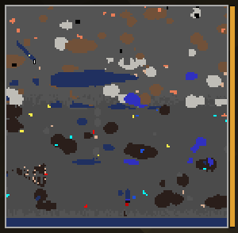

# Diamond CRT

The wide view.

> *Near, far, and the whole mountain.*

## How to make it
Smithing table: torch + [Gold CRT](Gold-CRT.md) + [Diamond Picture Tube](Picture-Tubes.md).

## What it shows
- In color, with three zoom steps on **B**: 32×32, 64×64 and **128×128 blocks**.
- At 128 a block is a single pixel. Ores are small then; switch to 32 to look closely.

## Modules
**3 module slots.**

## Upgrade
The vanilla way: smithing table with a netherite upgrade template + Diamond CRT + netherite
ingot → [Netherite CRT](Netherite-CRT.md).

---
[Home](Home.md) · [Getting Started](Getting-Started.md) · [Best Practice](Best-Practice.md)
