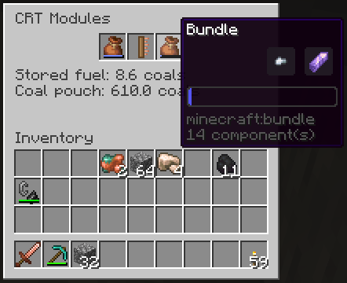
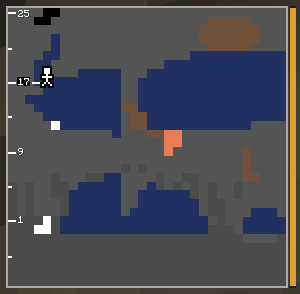

# Finder Bundle

A bundle with an **amethyst shard** in it, in a module slot. It makes chosen ores flash in the
picture.

## Samples
Put a sample of each ore you want into the bundle. A sample is anything made of the ore:
raw ore, ingot, a single nugget, gem, dust or block. Supported: coal, iron, copper, gold,
redstone, lapis, diamond, emerald, quartz, and netherite scrap for ancient debris; deepslate and
nether variants are included.

**Modded ores** work too when the mod uses the common `c:` tags: an item in `c:ingots/tin` finds the
blocks in `c:ores/tin`.

A **chest** as sample (chest, trapped chest, or modded chests) makes every block that stores items or fluids
flash: chests, barrels, shulker boxes, hoppers, furnaces, and modded storage such as drawers, tanks and
pipes, even when they are painted or hidden. Cauldrons don't count.

## The flash
Each found block flashes in four steps: white, its own color, black, its own color. With
several samples you can still tell which ore is which.

## Notes
- Nothing in a finder bundle is ever burned, coal included.
- It works from the [Copper CRT](Copper-CRT.md) on; the Stone CRT has no module slots.

---
[Home](Home.md) · [Getting Started](Getting-Started.md) · [Best Practice](Best-Practice.md)
