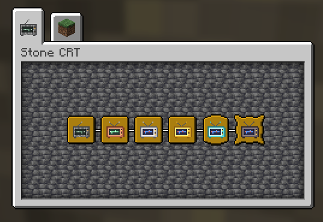
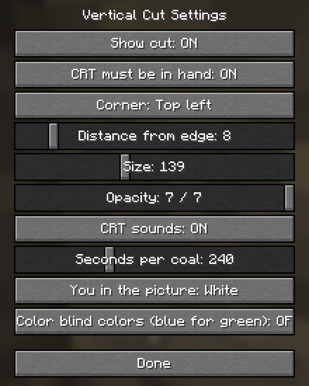

# Getting Started

## 1. Install
Download the mod from [Modrinth](https://modrinth.com/mod/vertical-cut) or the [GitHub releases](https://github.com/Knito58/vertical-cut/releases).
Put the Vertical Cut jar and Fabric API into your `mods` folder (Fabric Loader for Minecraft 26.3).
On a server, the mod must be on the server too. Mod Menu is optional; it gives you the settings
screen.

## 2. Build your first CRT
You need 7 cobblestone (blackstone or cobbled deepslate work too), 1 glass pane and 1 torch:
```
C G C      C = cobblestone, G = glass pane
C T C      T = torch
C C C
```
The recipe shows up in the recipe book once you pick up cobblestone.

## 3. Feed it
A new CRT is empty. Carry coal or charcoal: the CRT takes one piece from your inventory
by itself whenever it runs dry, and you hear it gulp. One coal lasts 4 minutes of scanning. It only
burns while the cut is shown.

## 4. Look
Hold the CRT in your main hand or offhand and press **V**. The picture appears in a corner:
- black is air (caves),
- water is grey, lava blinks,
- you are the little stick figure, 16 pixels in from the left edge,
- the picture shows what lies in the direction you look.

Turn around and the cut turns with you. With the Stone CRT the picture lags a little behind
when you walk; stand still for a moment and it catches up.

## 5. When the coal runs out
The picture dies like an old TV: snow, grey, a white line, a dot, black. Pick up coal and it
comes back on.

## 6. Upgrade
Collect copper and make a [Copper Picture Tube](Picture-Tubes.md). On the smithing table:
torch (as template) + Stone CRT + Copper Picture Tube gives the [Copper CRT](Copper-CRT.md), which
shows ores. The fuel in the CRT carries over. The advancement tab "Vertical Cut" has a riddle for each
tier and shows how far you have come.



## Keys
| Key | What it does |
|---|---|
| V | Show or hide the cut |
| B | Zoom (Gold, Diamond, Netherite CRT) |
| K | Lock the direction ([Compass](Compass.md) module) |
| J | Look deeper ([Spyglass](Spyglass.md) module) |

Opacity and the settings screen have keys too, but they are unbound. Bind them in
Options → Controls → Key Binds → Vertical Cut.

## Settings



Mod Menu → Vertical Cut → Configure: CRT must be in hand (or anywhere in the inventory), corner,
distance from the edge, size, opacity, CRT sounds, seconds per coal (60 to 600), the color of
your stick figure, and color blind colors (blue instead of green). Hold **Shift** over any
Vertical Cut item for a short explanation.


---
[Home](Home.md) · [Getting Started](Getting-Started.md) · [Best Practice](Best-Practice.md)
