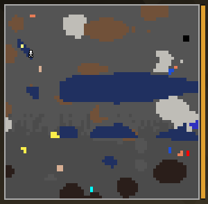
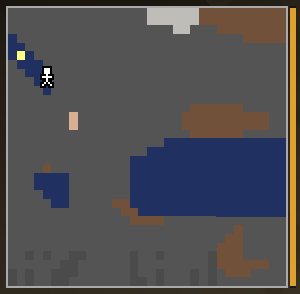

# Gold CRT

Like the Iron CRT, but it can zoom in.

> *Gold leans closer for tired eyes.*

| Zoomed out: 64×64 blocks | Zoomed in with **B**: 32×32 blocks |
|---|---|
|  |  |

## How to make it
Smithing table: torch + [Iron CRT](Iron-CRT.md) + [Gold Picture Tube](Picture-Tubes.md).

## What it shows
- 64×64 blocks, in color.
- **B** zooms in to 32×32 blocks and back out. Each switch gives a moment of snow and a click
  while the tube refocuses. The zoom step is remembered.

## Modules
2 module slots.

## Upgrade
Smithing table: torch + Gold CRT + [Diamond Picture Tube](Picture-Tubes.md) → [Diamond CRT](Diamond-CRT.md).

---
[Home](Home.md) · [Getting Started](Getting-Started.md) · [Best Practice](Best-Practice.md)
