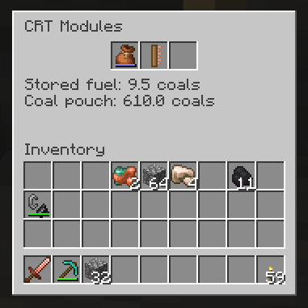

# Vertical Cut Wiki

Vertical Cut is a Fabric mod for Minecraft 26.3. A device you carry, the **CRT**
(Coal-powered Rock Tomograph), draws a vertical cross-section of the ground in front of you in a
corner of the screen. You see caves, water, lava and, with the better CRTs, ores and living
things, without digging. The mod is needed on both the client and the server.

## Start here
- [Getting Started](Getting-Started.md): your first CRT in ten minutes.
- [Best Practice](Best-Practice.md): tips for mining, exploring and saving coal.

## The CRTs
Each one is made from the one before.

| CRT | Picture | Shows | Module slots |
|---|---|---|---|
| [Stone CRT](Stone-CRT.md) | 32×32, black and white, lags and flickers | caves, water, lava | 0 |
| [Copper CRT](Copper-CRT.md) | 32×32, black and white, steady | + ores | 1 |
| [Iron CRT](Iron-CRT.md) | 64×64, color | + ores in color | 2 |
| [Gold CRT](Gold-CRT.md) | 64×64, zoom in to 32×32 | same as Iron | 2 |
| [Diamond CRT](Diamond-CRT.md) | 32×32, 64×64 or 128×128 | same as Iron | 3 |
| [Netherite CRT](Netherite-CRT.md) | 32×32, 64×64 or 128×128 | + living things; immune to interference | 3 |

## Parts
- [Picture Tubes](Picture-Tubes.md): the upgrade parts, Copper to Diamond.
- [Depth Gauge](Depth-Gauge.md): a module that shows Y levels.

## Modules
Vanilla items you put into a CRT's module slots (sneak + right-click with the CRT):

- [Coal Pouch](Coal-Pouch.md): any bundle; the CRT eats from it, and anything a furnace burns.
- [Finder Bundle](Finder-Bundle.md): a bundle with an amethyst shard; makes chosen ores flash.
- [Lightning Rod](Lightning-Rod.md): shields against interference.
- [Compass](Compass.md): locks the direction of the cut.
- [Spyglass](Spyglass.md): looks one picture deeper.
- [Depth Gauge](Depth-Gauge.md): the ruler with Y levels.

Only one module of each kind works in a CRT.

## More
- [Behind the Cut](Behind-the-Cut.md): where this mod comes from and why it works the way it does.
