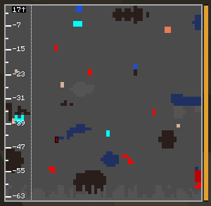

# Spyglass

A spyglass in a module slot. It looks one picture deeper.

## What it does
- **J** flips between the near picture (as usual) and the deep one.
- The deep picture continues where the near one ends, one full picture lower, but never below the
  bottom of the world.
- You stand above it: a dotted line in your color marks where you are, and a small plate with an
  arrow up at the top. Near the bottom of the world, where you fit into the picture, you are the
  stick figure again.
- Taking the spyglass out, the CRT running out of coal or hiding the cut brings back the near
  picture.

---
[Home](Home.md) · [Getting Started](Getting-Started.md) · [Best Practice](Best-Practice.md)
